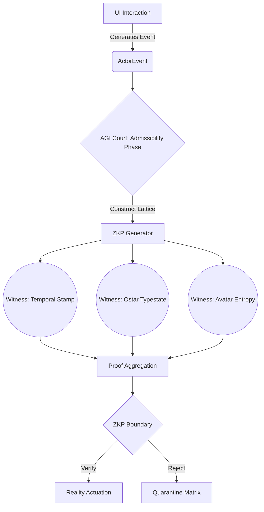

# Combinatorial Matrix 01: Ostar Governance $\times$ AGI Court

> **Ontological Scope:** Typestate-Bounded ZKP Epistemology  
> **Diátaxis Quadrant:** Explanation / Thesis (PhD-Level)  
> **Matrix Intersection:** `[Domain 1: Governance] ⊗ [Domain 2: AGI Court]`

## Abstract

This treatise exhaustively explores the combinatorial intersection between Constitutional Ostar Governance and the internal mechanisms of the AGI Court within the Post-Cyberpunk (PCP) Framework v30. By mapping the mathematical structures of semantic law enforcement directly onto Zero-Knowledge Proof (ZKP) boundaries, we derive a formal calculus of autonomic adjudication. This document asserts that governance in a multiperspective React Native matrix cannot rely on imperative validation; it must instead depend on the cryptographic undeniability of typestate conformance. 

Herein, we establish the **Axiom of Adjudicated State**, demonstrating how laws formulated in the Ostar generator are mathematically reduced to witness lattices and subsequently proven by the AGI Court before Reality Actuation (Blue River Dam) is permitted to fire.

---

## 1. The Typestate Calculus of Ostar Governance

Ostar Governance fundamentally shifts the paradigm of application security from *runtime imperative checks* to *compile-time and cryptographic typestate proofs*. 

### 1.1 The Semantic Law Equation

Let a Law $\mathcal{L}$ be defined as a tuple $(\mathcal{S}_{pre}, \mathcal{E}, \mathcal{S}_{post}, \mathcal{C})$, where:
- $\mathcal{S}_{pre}$ is the requisite prior state vector.
- $\mathcal{E}$ is the triggering event payload.
- $\mathcal{S}_{post}$ is the guaranteed posterior state.
- $\mathcal{C}$ is the consequential side-effect matrix (e.g., database mutations, UI holographics).

According to the **Chatman Equation** ($A = \mu(O)$), the Architecture ($A$) is purely a manifestation ($\mu$) of the Ontology ($O$). Therefore, if a Law $\mathcal{L}$ exists within $O$, the generative pipeline (`ggen`) must scaffold a Rust typestate that makes violating $\mathcal{L}$ syntactically impossible.

```rust
// Autonomic Governance Typestate Implementation
pub trait OstarLaw<E: Event> {
    type PreState: State;
    type PostState: State;
    type Consequence: EffectMatrix;

    fn evaluate(state: Self::PreState, event: E) -> Result<(Self::PostState, Self::Consequence), LawViolation>;
}

pub struct ActuationIntent {
    pub target_id: String,
    pub payload_hash: [u8; 32],
}

// The Typestate enforces that only ValidatedIntent can proceed to Actuation
pub struct ValidatedIntent(ActuationIntent, ZKPReceipt);
```

### 1.2 The Impossibility of State Regression

By utilizing Rust's ownership model mapped onto WebAssembly (WASM), we guarantee that once a `PreState` is consumed by the `evaluate` function, it ceases to exist in the memory topology. This completely eradicates the class of vulnerabilities known as Time-of-Check to Time-of-Use (TOCTOU), forming the absolute bedrock for the AGI Court's admissibility criteria.

---

## 2. Epistemology of the AGI Court

If Ostar Governance defines *what* must be proven, the AGI Court defines *how* truth is established in a trustless execution environment. The AGI Court is not a literal courtroom; it is a continuously evaluating cryptographic boundary within the React Native client that intercepts state transitions and subjects them to Zero-Knowledge Proof (ZKP) verification.

### 2.1 The Witness Lattice

When a user interacts with the UI (e.g., sliding a `GlassCard` or invoking an Avatar projection), the interaction generates an `ActorEvent`. This event is inherently untrusted.

The AGI Court intercepts the event and constructs a **Witness Lattice** ($\mathcal{W}$). The lattice is a directed acyclic graph (DAG) of cryptographic assertions.



### 2.2 Mathematical Formalization of the ZKP Boundary

Let $P(x, w)$ be a polynomial-time verifier that outputs $1$ if $w$ (the witness lattice) is a valid proof for the statement $x$ (the `ActorEvent` transitioning $\mathcal{S}_{pre} \rightarrow \mathcal{S}_{post}$).

The AGI Court utilizes a Non-Interactive Zero-Knowledge (NIZK) protocol (such as zk-SNARKs or STARKs bound to the WASM payload) where the prover (the local client state machine) generates a proof $\pi$:

$$ \pi \leftarrow Prove(pk, x, w) $$

The `ZKPBoundary` component in the React Native layer simply executes:

$$ Verify(vk, x, \pi) \in \{0, 1\} $$

If the output is $1$, the Court admits the transition. If $0$, the event is routed to the `actor_quarantine` table via Supabase, triggering an autonomic investigation.

### 2.3 React Native Integration: The `useAgiCourt` Hook

This abstract mathematics is directly materialized into the React Native architecture. The `useAgiCourt` hook is the bridge between the UI thread and the WASM verifier.

```typescript
import { useState, useCallback } from 'react';
import { useWasmCapability } from '@pcp/v30/capabilities';

export function useAgiCourt<TEvent, TState>() {
  const { executeWasmProof } = useWasmCapability('agi_court_zkp');
  const [verdict, setVerdict] = useState<'IDLE' | 'ADMITTED' | 'REJECTED'>('IDLE');

  const submitClaim = useCallback(async (event: TEvent, preState: TState) => {
    try {
      // 1. Ostar Governance: Extract topological constraints
      const constraints = extractOstarConstraints(event);
      
      // 2. AGI Court: Generate proof via WASM
      const proof = await executeWasmProof({ event, preState, constraints });
      
      // 3. Boundary Verification
      const isValid = verifyZKP(proof);
      
      if (isValid) {
        setVerdict('ADMITTED');
        return proof.receipt; // BLAKE3 Receipt for Blue River Dam
      } else {
        setVerdict('REJECTED');
        quarantineEvent(event);
        throw new Error("AGI Court Rejected Claim: Typestate Conformance Failed.");
      }
    } catch (e) {
      setVerdict('REJECTED');
      throw e;
    }
  }, []);

  return { submitClaim, verdict };
}
```

---

## 3. Combinatorial Synthesis: Governance Executed via Court

The true maximalist power of the PCP framework is revealed when Governance and the Court operate in a synchronized feedback loop. 

### 3.1 The Causal Window

Ostar Governance laws are not evaluated instantaneously. They exist within a **Causal Window** ($\Delta t_{causal}$). The AGI Court must prove that an event occurred *within* its permissible causal window. If an event is delayed by network latency (Neural Latency Firewall), the AGI Court must factor temporal decay into the Witness Lattice.

1. **Governance Rule:** "A claim must be actuated within 5000ms of UI intent."
2. **AGI Court Witness:** Extracts the hardware-backed timestamp.
3. **Synthesis:** The ZKP circuit includes an arithmetic check: `timestamp_actuation - timestamp_intent < 5000`. If this check fails, the proof $\pi$ cannot be generated. The math simply will not compile.

### 3.2 The Holographic UI Response

When the AGI Court is deliberating, the UI must reflect this profound computational effort. The `HolographicGlassCard` component interpolates the `verdict` state.

```tsx
<HolographicGlassCard intensity={verdict === 'IDLE' ? 'low' : 'high'}>
  {verdict === 'ADMITTED' && <Text className="font-mono text-emerald-400">AXIOM VERIFIED</Text>}
  {verdict === 'REJECTED' && <Text className="font-mono text-rose-500">QUARANTINE ENGAGED</Text>}
</HolographicGlassCard>
```

---

## 4. Conclusion: The Axiom of Adjudicated State

The intersection of Ostar Governance and the AGI Court obliterates the traditional Model-View-Controller (MVC) paradigm. By forcing every state transition through a cryptographic bottleneck governed by immutable typestate laws, the PCP Framework v30 achieves *Axiomatic Truth* at the UI layer. 

The developer is no longer writing conditionals (`if (user.role === 'admin')`); the developer is defining the physics of the universe, and the AGI Court enforces those physics using the undeniable gravity of mathematics.
