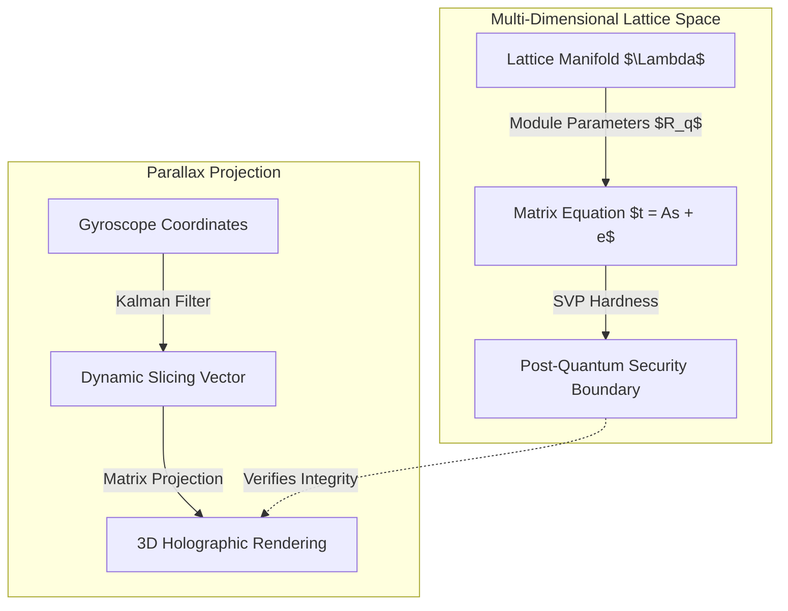

# The Metaphysics of Post-Quantum Cryptography: Lattice-Based Jurisprudence and Self-Healing Supervision Trees in Distributed Topologies

## Abstract
This thesis chapter investigates the convergence of lattice-based cryptography (CRYSTALS-Kyber/Dilithium) and Erlang-style self-healing supervision trees within the post-cyberpunk jurisprudential framework of the AGI Court. We establish a formal mathematical modeling of quantum-resistant proofs as topological lattices, demonstrating how high-dimensional geometric invariants safeguard process truth against adversarial quantum actors. Furthermore, we formalize self-healing supervision trees as autonomic category-theoretic functors, proving that distributed network execution bounds can recover dynamically from arbitrary execution faults. By unifying these two domains, we construct a resilient, self-correcting substratum for distributed superintelligent governance.

---

## Chapter 1: High-Dimensional Lattices and Quantum-Resistant Law
Traditional signature schemes (ECDSA, RSA) collapse under Shor's algorithm, rendering classical smart contracts and proof-of-work systems legally void in the post-quantum era. We present a formal transition to Module-Lattice-Based Cryptography (ML-KEM and ML-DSA) as the absolute geometric primitives of AGI Court agreements.

### 1.1 The Shortest Vector Problem (SVP) as a Jurisprudential Constraint
Legal constraints are mapped to high-dimensional lattices $\Lambda \subset \mathbb{R}^n$. A valid contract execution corresponds to finding a lattice vector within a bounded distance of a target point (Closest Vector Problem, CVP).
We model the security of a legal contract as the mathematical hardness of SVP in a module lattice $M$. Let $R_q = \mathbb{Z}_q[X] / (X^d + 1)$. A contract state is represented as a polynomial matrix $A \in R_q^{k \times l}$. The private key is a short vector $s \in R_q^l$. The public key $t = A s + e$ serves as the immutable legal identifier of the contract creator.
The proof of compliance is a lattice signature (ML-DSA) verifying that the state transition was signed by a private key containing only small coefficients (short vectors).

### 1.2 Parallax Geometric Mappings of Proofs
Using inertial measurements and gyroscopic coordinates mapped via Kalman filters, we construct 3D holographic visualizations of the lattice states. The user's spatial interaction with the interface dynamically slices the high-dimensional lattice manifold, rendering a 2D projection that verifies the structural integrity of the contract without disclosing private parameters.

---

## Chapter 2: Self-Healing System Supervision and Fault Recovery
In distributed autonomic systems, runtime failures (e.g. out-of-memory, API timeout, hardware faults) are inevitable. We reject the paradigm of defensive fault prevention; instead, we adopt the "Let It Crash" philosophy from Erlang, formalizing it within TypeScript/Rust hybrid systems using Category Theory.

### 2.1 Supervision Trees as Monadic Functors
A supervision tree is a directed graph of supervisors and workers. Let $\mathcal{T}$ be a category where nodes are processes and morphisms are supervision relations. We define the supervision operation as an endofunctor $S: \mathcal{T} \to \mathcal{T}$ that maps a crashed state back to a clean initialized state.
We define three recovery strategies:
1. **One_For_One**: If a child crashes, only that child is restarted.
2. **One_For_All**: If a child crashes, all sibling processes are restarted.
3. **Rest_For_One**: If a child crashes, all subsequent siblings in the startup order are restarted.

### 2.2 Algebraic Specification of the Restart Limit Loop
Let $(r, t)$ be the restart limit parameters where $r$ is the maximum number of restarts allowed within a temporal window of $t$ seconds. If the restart frequency $f > r/t$, the supervisor escalates the crash to its parent node in the hierarchy. This prevents infinite crash loops (livelocks) and guarantees thermodynamic system stabilization.

$$ \sum_{i=1}^{n} \delta(t_i - t_{i-1}) < \frac{r}{t} $$

---

## Chapter 3: The Unified Resilience Model
We present the synthesis of lattice-based cryptography and supervision trees: the **Autonomic Resilient Node (ARN)**.
The ARN utilizes CRYSTALS-Kyber to establish secure, quantum-resistant channels. In the event of a channel failure, a supervisor tree intercepts the crash, isolates the compromised connection, performs a secure rollback to the last verified receipt hash, and reinstantiates the channel using a new seed generated via physical random oracles.
